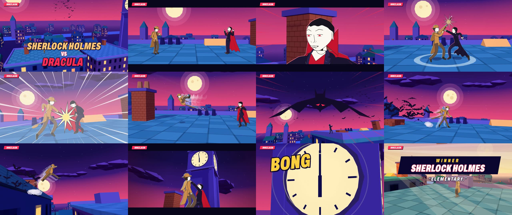

# INKCLASH: showdown animation studio

Short, stylised fights between characters from different stories. Everything on screen is drawn by code:

- **Characters are pen drawings.** They use the fine-liner rig from [penline-studio](https://github.com/ravish0409/penline-studio): thin ink outlines, flat fills, faces that pop between expressions. They move on twos like drawn animation.
- **Backgrounds are low-poly 3D.** A real three.js scene with flat-shaded facets, a few hard-pixel textures and strong colour. It is rendered through the same camera as the figures, so both share one perspective, one shake and one depth order.
- **Action is pose-to-pose.** Named key poses, snap and whip easing, anticipation before a move, a held frame on contact, then a two-frame impact (black on white, white on colour), shake, dust and debris.
- **Detail follows the shot.** Close-ups get the full face, hair strands and clothes. In wide scale shots the same figure drops to a flat silhouette with a rim light, and effects are flat shapes held for two or three frames, the way anime saves its drawing for where it counts.

No AI video and no stock assets. The soundtrack is synthesised from a cue sheet too.

## Round 01: Sherlock Holmes vs Dracula

`out/ep01.mp4`, 38.5 s, 1920×1080, 24 fps.



Dracula is stronger and faster, so Holmes fights for time. He checks his watch before the first blow, loses his cane, goes through a chimney, runs, and lets himself be caught under the clock tower at 5:59. Then the clock strikes six.

Both characters are in the public domain and drawn in our own designs. See [Choosing characters](#choosing-characters).

## Build

Needs Node with Playwright (Chromium), Python 3 with numpy and scipy, and ffmpeg.

```bash
tools/build.sh ep01 4      # cue sheet -> soundtrack -> frames (4 parallel renderers) -> out/ep01.mp4
```

While working on a shot:

```bash
node tools/render.js snap 9.5 13.1             # stills            -> out/tmp/snap/t_9.50.jpg
node tools/render.js sheet 7.3 7.4 7.5 7.6     # contact sheet     -> out/tmp/snap/sheet.jpg
node tools/render.js poses guard,jab,kick holmes   # check key poses from two angles
```

Or serve this folder (`python3 -m http.server`) and open `player.html?ep=ep01` to watch it play, or `player.html?ep=ep01&t=12.5` for one frame. WebGL runs in software (SwiftShader) in the renderer, so frames come out the same on any machine.

## How it fits together

```
player.html            one page that plays any episode: builds each frame, in order
engine/
  vendor/              pen.js, rig.js, rig_fine.js from penline-studio (rig_fine has a few marked [showdown] patches); three.js
  stage.js             the low-poly world: renders the set with PEN's camera and paints it under (and over) the cast
  act.js               action: IK solver, key poses, keyframe tracks, capes, rim light, afterimages
  fx.js                drawn effects: speed lines, bursts, slashes, trails, dust, debris, bats, embers, lettering
episodes/ep01/
  set.js               the place (London rooftops): geometry, palette, night-to-dawn lighting
  cast.js              who is in it: looks, cloth, props
  shots.js             the performance: both actors' tracks, every shot's camera and effects, sound cues
tools/
  render.js            headless renderer: stills, contact sheets, pose sheets, cue sheet, all frames
  audio.py             synthesises the score and every sound effect from the cue sheet
  build.sh             the whole build
```

A frame is made in this order: the shot function sets the camera and lists what is in the frame; the stage paints the 3D background; actors and world effects are drawn far to near; the stage can paint anything nearer than the cast back on top (`c.near = true`); screen effects go last; a little paper grain ties it together.

### Actors and tracks (`act.js`)

A pose is a small object: hand targets `hL hR` (relative to the chest, so twisting the spine throws the punch), foot targets `fL fR`, spine `lean twist side`, whole-body `pitch roll`, pelvis `bob sx sz`. `ACT.POSES` has about thirty named ones (`guard`, `jab`, `cross`, `kick`, `dodgeBack`, `duck`, `claw`, `hitGut`, `fly`, `crashed`, `leap`, `land`, `caneStrike` and so on). Write `"guard"`, `["claw", "mirror"]` or `["guard", { headPitch: -0.5 }]`.

A track is a list of keys in frames at 12 fps. Anything a key leaves out carries over from the one before:

```js
[112, { pose: "caneWind", pos: [-2.8, 0, 0], ease: "out" }],   // anticipation
[114, { pose: strike, pos: [-2.5, 0, 0], ease: "whip" }],      // nothing, then all at once: the hit lands on frame 114
[118, {}],                                                     // hold
```

Eases: `snap` (default), `whip` (for hits), `pop`, `hold`, `io`, `out`, `in`, `lin`, `back`. `arc` adds a jump height, `cycle: { rate }` runs until the next key, `expr` sets the face, `flag` passes switches to props, `cut: true` marks a teleport so cloth does not streak across it.

Cloth (capes, coat tails) hangs each row from where the body was a moment earlier, so it streams behind a dash and settles after it. It cannot stretch past its own length.

### Shots (`shots.js`)

```js
S.hit1 = (c) => {
  c.cam([-2.6, 0.75, 4.2], [-1.7, 1.2, 0], 40, -0.06);   // position, look-at, fov, roll
  rattle(c, [[114, 44]]);                                // shake that rings out after frame 114
  impact(c, 114, tip);                                   // the two-frame impact, then a flash
  cast(c, { fps: 24 });                                  // both actors, on ones for this shot
  c.under((g) => FX.dust(g, [-0.9, 0, -0.15], c.t - F(115), { push: [1.4, 0, 0] }));
};
```

`c.env` drives the set (`dawn`, `smash`, `clock`). `c.actor(A, { solid, rim, ghosts, fps })` picks the level of detail per shot.

### Sound

`EP.cues` in `shots.js` lists `[frame, sound, loudness, pan, length]`; `EP.score` lists what the music is doing by section. `tools/audio.py` synthesises all of it (drums, bass, pads, hits, whooshes, bats, the bell) and the build normalises the mix to -14 LUFS. To use a licensed track instead, swap `out/tmp/audio.wav` before the encode step.

## Making the next round

1. Copy `episodes/ep01` to `episodes/ep02`.
2. `set.js`: build the place from boxes, prisms and cones with `K.mesh`, pick a palette, keep it bright.
3. `cast.js`: start from a rig preset (`kind`) and override `look`; add cloth and a prop. Check with `node tools/render.js poses stand,guard <name>`.
4. `shots.js`: write the two tracks first (the fight), then cut it into shots, then add effects and cues.
5. `tools/build.sh ep02`.

For vertical Shorts, set `window.PEN_SIZE = [1080, 1920]` in `player.html` (and the viewport in `render.js`) and reframe the cameras.

## Choosing characters

The engine can draw anyone the rig can dress. Which characters to use is a rights question, not a technical one:

- **Public domain** characters are free to use in your own designs: Holmes, Dracula, Frankenstein's creature, Robin Hood, Zorro, King Arthur, Sun Wukong, Hercules, the Norse and Greek gods, the Three Musketeers, Captain Nemo. Use the book or myth, not a studio's later film version of it.
- **Current film, anime, comic and game characters** are owned by their studios. Fan matchups are common on YouTube, but they can draw claims or takedowns and can block monetisation. That is your call to make per episode.

## Limits

- The rig draws adult male bodies in shirts, coats and trousers. Women, children, creatures, armour and long hair need new rig work in `rig_fine.js`.
- Hands are open; there is no fist or grip shape yet.
- The soundtrack is generated and has not been mixed by ear.
